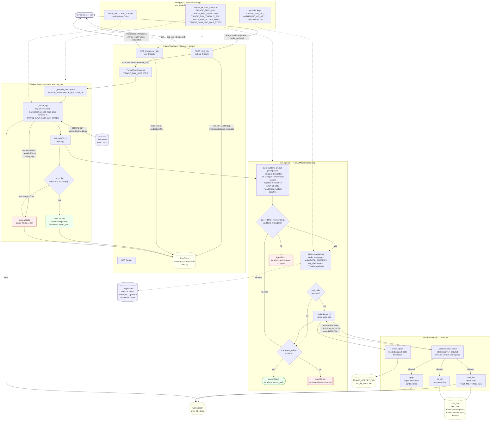

# Triage Agent — Architecture

Design reference for the `triage-agent` HTTP service. Focused on the
service itself; anything about the pipeline-side integration lives in
the `kernelci-pipeline` repo alongside the code that consumes this
service.

For the user-facing quickstart (setup, endpoints, env vars) see
[`README.md`](../README.md). This doc goes one level deeper — internals,
data flow, and the invariants a maintainer needs to know.

## What this service does

An HTTP service that takes a LAVA job id, fetches its log, runs the
`skills/kernel-triage` skill through a LiteLLM tool-calling loop, and
returns a Markdown root-cause analysis (RCA).

Every client (CI system, oncall UI, `curl`, another service) hits the
same three endpoints. The service has no built-in knowledge of any
specific client.

## Runtime architecture



## HTTP contract

Canonical reference. See `README.md` for user-friendly examples.

### `POST /{job_id}`

- **Path**: `job_id` is a LAVA job id (integer as string). Reserved
  names `health`, `triage`, `docs`, `openapi.json`, `redoc` are
  rejected with **HTTP 400**.
- **Body** (optional):
  ```json
  {
    "model": "anthropic/claude-4-5-sonnet",
    "model_options": {"temperature": 0.1},
    "log_url": "https://…/lava.log.gz"
  }
  ```
  `model` overrides `TRIAGE_MODEL_DEFAULT`. `model_options` is merged
  verbatim into `litellm.completion(...)`. `log_url` short-circuits the
  LAVA REST fetch — if the caller already has the sanitised log in a
  known location, the runner downloads from that URL first and falls
  back to the LAVA REST API on any failure.
- **Response**: `202 Accepted`, `{"run_id": "...", "status": "queued"}`
- **Rate limit**: **HTTP 503** when `TRIAGE_MAX_ACTIVE_RUNS` in-flight
  is reached. Message: `too many active runs (N/M); retry later`.

### `GET /triage/{run_id}`

- **Response** — full run record, plus the report body inlined when
  status is `completed`:
  ```json
  {
    "run_id": "...", "job_id": "...", "model": "...",
    "status": "queued|running|completed|failed",
    "started_at": "...", "finished_at": "...",
    "iterations": N,
    "report_path": "./reports/<run_id>_report.md",
    "report": "# Executive Summary\n...",
    "error": null
  }
  ```
- **404** if `run_id` is unknown. **In-memory only** — every run
  disappears from this endpoint after a process restart. The report
  *file* on disk survives.

### `GET /health`

Liveness + config snapshot:

```json
{
  "status": "ok",
  "default_model": "...",
  "skill_dir": "...",
  "active_runs": N
}
```

## Internal data flow

```
POST /{job_id}
  └─ api.submit_triage
       ├─ store.create(RunRecord, status=queued)
       └─ executor.submit(runner.execute_run)  ─── worker thread
                                                    │
                                                    ▼
                                             runner.execute_run
                                                    │
                                                    ├─ prepare ./runs/<run_id>/
                                                    ├─ fetch log:
                                                    │    1) HTTP GET log_url (if given)
                                                    │    2) LavaClient.get_job_logs_plain(job_id)
                                                    ├─ truncate at TRIAGE_LAVA_LOG_MAX_BYTES
                                                    │  with a sentinel marker
                                                    ├─ agent.run_agent  ← LiteLLM tool loop
                                                    │    ├─ read_file, list_dir, grep
                                                    │    └─ write_report → sets report_written=True
                                                    │       → loop terminates
                                                    └─ store.update(status=completed)
```

Every failure path in `runner.execute_run` routes through a local
`fail()` closure that calls `store.update(status="failed", error=...)`.
Callers can parse the error string to classify (log fetch vs LLM error
vs empty report vs internal error).

## Sandbox

`agent_service/tools.py` exposes four tools to the model:

- `read_file(path, offset, limit)` — line-windowed
- `list_dir(path)` — non-recursive
- `grep(path, pattern, max_matches, context)` — streamed line-by-line
- `write_report(content)` — the loop terminator

**Path resolution rules** (in `_resolve_and_check`):

1. Relative paths resolve against `run_workspace`.
2. Absolute paths are used as given.
3. `resolve(strict=True)` — follows symlinks, requires the target to
   exist.
4. The real resolved path must live under `skill_dir` OR
   `run_workspace`. Anything else raises `ToolError`.

**`write_report` is special:** it ignores any path argument the model
sends and writes to `AgentContext.report_path`, which the runner
fixes at run start. Path-traversal via tool args is impossible by
construction.

Tool errors are returned to the model as JSON `{"error": "..."}` so
it can adapt on the next iteration; they never bubble to HTTP 500.

## Termination conditions

The agent loop in `agent.py` terminates on the first of:

1. `write_report` succeeds → success.
2. Assistant returns no `tool_calls` and the report was not written →
   `AgentError`, run marked failed.
3. Iteration cap reached (`TRIAGE_MAX_ITERATIONS`, default 40) →
   `AgentError`.
4. Wall-clock deadline exceeded (`TRIAGE_RUN_TIMEOUT_SEC`, default
   1800s), checked at the top of each iteration → `AgentError`.

## State model

`agent_service/store.RunStore` — a thread-safe dict of `RunRecord`
keyed by `run_id`. Guarded by a single `threading.RLock`. Access is
short and predictable, so per-record locking is not worth the
complexity.

**In-memory only.** Process restart drops every record. Report files
on disk survive (`./reports/<run_id>_report.md`) but cannot be queried
back through the HTTP layer after restart. This is intentional; see
"Non-goals" below.

## Configuration

Environment-driven. See `.env.example` for the full menu and
`README.md` for the user-facing summary. Key knobs:

- `TRIAGE_MODEL_DEFAULT` — LiteLLM model string; per-request override
  via the `model` field on `POST`.
- `TRIAGE_WORKSPACE_ROOT`, `TRIAGE_REPORT_DIR` — where the runner writes
  per-run workspaces and the final RCA. Both default to project-relative
  paths (`./runs`, `./reports`) that are gitignored.
- `TRIAGE_MAX_WORKERS` — thread pool size for concurrent runs.
- `TRIAGE_MAX_ACTIVE_RUNS` — soft cap on queued + running work; over
  this, `POST` returns 503.
- `TRIAGE_MAX_ITERATIONS`, `TRIAGE_RUN_TIMEOUT_SEC` — per-run bounds.
- `TRIAGE_LAVA_LOG_MAX_BYTES` — log truncation limit.
- `TRIAGE_LLM_CA_BUNDLE`, `TRIAGE_LLM_SSL_VERIFY` — corporate TLS
  escape hatches; must be applied *before* any LiteLLM call.

LAVA credentials (`LAVA_URL`, `LAVA_TOKEN`) and provider credentials
(`OPENAI_API_KEY`, `ANTHROPIC_API_KEY`, …) are read directly by the
respective client libraries from `os.environ`.

## Skill contract

`skills/kernel-triage/SKILL.md` is inlined into the system prompt.
It mandates: *"First read `references/triage.md` in full before doing
anything else."* The four `cots-*.md` files under `references/` carry
the actual triage logic and are pulled by the model via `read_file`
on demand. The report layout lives at `assets/report-template.md`.

The system prompt in `agent_service/prompts.py` deliberately keeps
the prompt cold-start cost flat as the skill grows: it inlines
`SKILL.md` + directory listings only, never the CoT files themselves.
Prompt caching then works on the fixed `SKILL.md` prefix.

## Directory layout

```
agent_service/          the HTTP service (10 modules)
  main.py               FastAPI app factory + uvicorn entrypoint
  api.py                route handlers
  config.py             pydantic-settings Settings
  schemas.py            request/response models
  store.py              thread-safe in-memory RunStore
  runner.py             worker thread body
  agent.py              LiteLLM tool-calling loop
  tools.py              sandboxed file tools + JSON schemas
  prompts.py            system prompt builder
lava_helper_script/     LavaClient — LAVA REST v0.2 client
  smoke_test/           standalone scripts against a real LAVA
skills/kernel-triage/   the RCA skill (SKILL.md + refs + assets)
docs/                   this file (design reference)
```

## Related documents

- [`README.md`](../README.md) — quickstart, endpoints, smoke test
- [`../skills/kernel-triage/SKILL.md`](../skills/kernel-triage/SKILL.md) — the skill entrypoint
